  

# 🚀 Awesome AI-Driven Test Case Generation 🧪

  <strong>Curated directory of next-generation Autonomous QA Agents, Requirement-to-Test Authoring Platforms, Self-Healing Playwright/Selenium frameworks, and Self-Hosted RAG Testing Systems.</strong>

  <a href="#-sector-overview--market-dynamics">Sector Overview</a> •
  <a href="#-saashosted-platforms">SaaS Platforms</a> •
  <a href="#-open-source-github-projects">Open-Source Projects</a> •
  <a href="#-how-to-contribute">How to Contribute</a> •
  <a href="#-support--sponsor">Support</a> •
  <a href="#-star-history">Star History</a>

---

## 🧭 Overview & SEO Meta Summary

This authoritative directory tracks cutting-edge **AI-driven test case generation**, **autonomous QA agents**, **natural language test authoring**, and **self-healing script tools**. As software engineering accelerates with generative coding assistants, modern QA teams leverage AI test generators to ingest Product Requirement Documents (PRDs), user stories, Jira tickets, and production analytics—synthesizing end-to-end (E2E) journeys, edge-case unit suites, and self-repairing test automation in minutes.

---

## 📈 Sector Overview & Market Dynamics

> 💡 **Market Size:** The global AI-powered software testing and QA market is valued at approximately **$9.32B – $11.99B (2025–2026)** and projected to surge past **$35B by the early 2030s** at an aggressive **CAGR of ~26%**. The narrower pure-play AI automated test generation niche sits at roughly **$1.0B – $1.2B** as autonomous testing agents gain widespread adoption.
>
> 🌐 **Market Dynamics:** The sector is **moderately fragmented and rapidly bifurcating**:
> - At the enterprise top layer, entrenched quality engineering incumbents (e.g., *Tricentis* at a ~$4.5B valuation and *BrowserStack* at ~$4.0B) operate with high concentration and platform lock-in by acquiring and integrating AI agents across their testing clouds.
> - Meanwhile, a fiercely competitive, highly innovative challenger layer of agentic startups (e.g., *Qodo/CodiumAI*, *testRigor*, *Functionize*, *Shortest*) is unbundling traditional QA workflows with specialized requirement-to-code pipelines, MCP servers, and LLM orchestration, making a winner-take-all outcome unlikely in the near term.

---

## 📑 Table of Contents

- [📈 Sector Overview & Market Dynamics](#-sector-overview--market-dynamics)
- [☁️ SaaS/Hosted Platforms](#️-saashosted-platforms)
  - [📊 SaaS Comparison & Valuation Leaderboard](#-saas-comparison--valuation-leaderboard)
  - [🔍 Platform Deep-Dives](#-platform-deep-dives)
- [🐙 Open-Source GitHub Projects](#-open-source-github-projects)
- [🤝 How to Contribute](#-how-to-contribute)
- [⚠️ Disclaimer](#️-disclaimer)
- [💖 Support & Sponsor](#-support--sponsor)
- [⭐ Star History](#-star-history)

---

## ☁️ SaaS/Hosted Platforms

### 📊 SaaS Comparison & Valuation Leaderboard

The following commercial AI test generation platforms are sorted descending by **company scale (valuation / estimated ARR)**:

| Platform | Company Scale (Valuation / ARR) | Description | Specific Starting Tier Pricing | Specific Free Tier / Trial Limits |
| :--- | :--- | :--- | :--- | :--- |
| **Tricentis Tosca AI** | **$4.5B Valuation** (~$500M ARR) | Enterprise model-based test automation; autonomously generates tests from natural language and Jira requirements. | Base tier starts at **€20,000/year** (custom enterprise quote) | **14-day free trial**; evaluation sandbox only; 0 permanent free tier |
| **Testim Copilot (Tricentis)** | **$4.5B Valuation** (Tricentis subsidiary) | Generative AI inside Testim test builder; autocompletes test steps, explains JavaScript code, and auto-repairs flaky locators. | Starts at **$300/month** (per parallel execution slot; custom quote) | **7-day free trial** with full cloud authoring; restricted Community tier capped to local single-run |
| **BrowserStack Test Case Generator** | **$4B Valuation** (~$230M ARR) | AI requirement-to-test agent converting PRDs and user stories into manual test cases and automated scripts. | Starts at **$99/month** (BrowserStack Automate plan; billed annually) | **14-day free trial** with 100 test automation minutes; 0 permanent free tier for AI agents |
| **Qodo (formerly CodiumAI)** | **$280M Valuation** ($120M raised) | AI code analysis & unit test generation suite (Qodo Gen for IDEs, Qodo Merge for PR test assertions). | Paid Developer plan starts at **$19/user/month** (annual billing) | **Free Forever plan** with individual IDE seat & community features (unlimited basic unit test suggestions) |
| **Functionize Architect** | **$164M Valuation** (~$17M ARR) | Chrome extension & cloud platform transforming user clickthrough journeys into self-healing, parameterized automated tests. | Growth tier starts at **$20/month** (includes 3.2M credits) | **Free Forever plan** with **800,000 credits/month** and up to 5 parallel execution runs |
| **Katalon Run with AI** | **$100M–$250M Valuation** (~$36M ARR) | Agentic AI executing plain language test instructions directly on live web apps, auto-generating Katalon Studio test scripts. | Studio Enterprise starts at **$229/seat/month** | **30-day free trial** of Katalon Studio Enterprise; free basic Studio license without Run with AI agent |
| **Qase AI** | **~$42M Valuation** (~$5M ARR) | AI QA copilot in Qase test management; generates test cases from Jira/specifications and exports to Playwright/Cypress. | Teams tier starts at **$35/user/month** (annual billing; 2,000 AI credits/mo) | **Free Forever plan** for up to **4 users, 2 projects, 500MB storage**; AI generation requires paid plan |
| **testRigor** | **~$15M ARR** ($7.6M raised, YC backed) | No-code generative AI test automation authoring tests in plain conversational English without selectors. | Private tiers start at **$1,800/month** (flat infrastructure billing) | **Free Forever for Public/Open-Source** repos (all test runs public); **14-day free trial** for private testing |
| **aqua cloud AI Copilot** | **~$8.6M ARR** (andagon GmbH subsidiary) | AI test management generating multi-step positive and negative test paths with requirement traceability. | DEV / Test Runner license starts at **€19/user/month**; Full Manager at **€89/mo** | **30-day free trial** with full manager capabilities; unlimited free read-only guest licenses |
| **Testmo AI** | **Bootstrapped / Profitable** (GmbH) | Native AI test case generation embedded into unified test management for manual, exploratory, and automated tests. | Team plan starts at **$59/month** (flat pack includes up to 5 user seats) | **21-day free trial** with full feature access; 0 permanent free tier |

---

### 🔍 Platform Deep-Dives

- **Tricentis Tosca AI** 🏢
  **Agentic test automation for enterprise quality engineering**.
  - **Features**: *Agentic Test Automation* autonomously plans and generates tests from natural language requests; early adopters cut creation time from 40 minutes down to 5; *AI Chat* converts Jira specifications directly into step-by-step test cases; *MCP Services* connects custom enterprise LLMs; centralized governance via *AI Workspace*.
  - **Pricing**: Base enterprise tier starts at **€20,000/year** (quote-only; credit-tracked).
  - **Free Tier / Trial**: **14-day free trial**; no permanent free tier.
  - **Best for**: Large enterprises requiring strict quality governance and SAP/mission-critical system test generation.

- **Testim Copilot (Tricentis)** 🧪
  **Generative AI authoring within the Testim test recorder**.
  - **Features**: Generates custom JavaScript/TypeScript test actions from descriptive text; explains complex existing logic; suggests automated fixes for breaking locators; integrates seamlessly into CI/CD pipelines.
  - **Pricing**: Starts around **$300/month** per parallel slot (quote-based enterprise tier).
  - **Free Tier / Trial**: **7-day free trial**; restricted Community tier for local execution.
  - **Best for**: Web testing teams seeking low-code AI-assisted test authoring.

- **BrowserStack Test Case Generator** 🌐
  **Autonomous requirement-to-test agent**.
  - **Features**: Analyzes PRDs, Figma flows, and user stories to produce structured test cases; detects edge cases and validates business logic; claims **90% faster test creation**, **91% accuracy**, and **92% coverage**; Currys reported **4X test coverage expansion**.
  - **Pricing**: Bundled with BrowserStack AI; **Automate starts at $99/month**.
  - **Free Tier / Trial**: **14-day free trial** (100 automated testing minutes); no free tier for AI agents.
  - **Best for**: Teams already standardized on BrowserStack wanting turnkey cloud test generation.

- **Qodo (formerly CodiumAI)** 🧑‍💻
  **AI test generation and codebase verification platform**.
  - **Features**: *Qodo Gen* analyzes function boundaries to suggest unit tests and uncover edge-case regressions directly in VS Code / JetBrains; *Qodo Merge* reviews PRs and synthesizes test assertions before merges.
  - **Pricing**: Paid Developer plan starts at **$19/user/month**; custom Enterprise tiers.
  - **Free Tier / Trial**: **Free Forever plan** for individual developers with basic unit test generation.
  - **Best for**: Software developers wanting intelligent unit test scaffolding inside their IDE.

- **Functionize Architect** 🧩
  **Intelligent click-through test authoring with self-healing**.
  - **Features**: Captures user interactions via Chrome Extension; generates self-healing machine-learning test cases; dynamic data generation; visual and API assertions; automated broken step remediation.
  - **Pricing**: Growth plan starts at **$20/month** (3.2M credits); Scale at $100/month.
  - **Free Tier / Trial**: **Free Forever plan** offering **800,000 credits/month** and 5 parallel test runs.
  - **Best for**: Fast-moving QA teams wanting visual click-through test creation with generous free credits.

- **Katalon Run with AI** ⚡
  **Agentic requirement-to-script execution engine**.
  - **Features**: *Run with AI* executes plain English test instructions on live applications and returns a ready-to-run Katalon Studio script; supports internal staging apps via secure tunnel; *True Production Insights* derives test cases from real user behavioral telemetry.
  - **Pricing**: Studio Enterprise starts at **$229/seat/month**.
  - **Free Tier / Trial**: **30-day free trial** of Enterprise; free baseline Katalon Studio license available.
  - **Best for**: Quality teams seeking automated plain-language to executable script compilation.

- **Qase AI** 📋
  **AI testing companion inside Qase test management**.
  - **Features**: Synthesizes structured manual test cases directly from linked Jira, GitHub, or specification tickets; estimates automation feasibility; exports manual scenarios to Playwright, Cypress, and Selenium code.
  - **Pricing**: Teams plan starts at **$35/user/month** (includes 2,000 AIDEN AI credits/month).
  - **Free Tier / Trial**: **Free Forever plan** for up to **4 users and 2 projects** (AI requires paid tier).
  - **Best for**: QA leads looking for unified test case management with embedded AI creation credits.

- **testRigor** 🗣️
  **Generative AI test automation with conversational English authoring**.
  - **Features**: Build and maintain web, mobile, and API tests entirely in conversational English without CSS/XPath locators; autonomously adapts to DOM structural changes; zero coding knowledge required.
  - **Pricing**: Private enterprise tiers start at **$1,800/month** (flat infrastructure billing; unlimited seats/runs).
  - **Free Tier / Trial**: **Free Forever tier for open-source / public test suites**; **14-day free trial** for private testing.
  - **Best for**: Manual QA engineers, business analysts, and product managers authoring tests without code.

- **aqua cloud AI Copilot** 💧
  **Structured requirement-to-test case generation**.
  - **Features**: Generates granular positive and negative test cases from requirements; customizable step boundaries (3–12 steps); automatic two-way traceability linking generated test cases to Jira/requirements.
  - **Pricing**: Execution / DEV license starts at **€19/user/month**; Full Manager license at **€89/month**.
  - **Free Tier / Trial**: **30-day free trial** with full capabilities; unlimited free read-only guest licenses.
  - **Best for**: Regulated enterprises (automotive, healthcare, banking) demanding full audit traceability.

- **Testmo AI** 🎯
  **Human-in-the-loop requirement test case synthesis**.
  - **Features**: Generates structured, reviewable test cases directly from requirements inside Testmo; outputs canonical formats (Steps, Text, BDD/Gherkin); controls generation density (10–60 test cases per prompt).
  - **Pricing**: Team plan starts at **$59/month** (includes up to 5 user seats; no AI add-on fee).
  - **Free Tier / Trial**: **21-day free trial** with all features enabled; no permanent free tier.
  - **Best for**: Modern teams wanting fast, transparent test management with AI assistance included out of the box.

---

## 🐙 Open-Source GitHub Projects

The following open-source AI test generation and self-healing tools are **sorted descending by GitHub Stars_Count**:

- **[Shortest](https://github.com/antiwork/shortest)**  ⚡
  **QA via natural language AI tests**.
  - **Features**: End-to-end AI test execution framework running natural language instructions directly via Playwright; self-improves and learns from execution traces; integrates with GitHub Actions for automated regression pipelines.
  - **Tech Stack**: TypeScript, Playwright, Anthropic Claude.
  - **License**: MIT.
  - **Best for**: QA engineers wanting natural language driven E2E test execution.

- **[Qodo-Cover](https://github.com/qodo-ai/qodo-cover)**  🛡️
  **AI-powered automated test generation and coverage enhancement tool**.
  - **Features**: Analyzes existing repository codebases, detects missing code coverage branches, and automatically generates valid unit test suites to increase test coverage; integrates directly into CI/CD pipelines.
  - **Tech Stack**: Python, LLM orchestration.
  - **License**: AGPL-3.0.
  - **Best for**: Automated unit test suite generation and code coverage improvement in CI/CD.

- **[Pynguin](https://github.com/se2p/pynguin)**  🐍
  **The PYthoN General UnIt Test geNerator**.
  - **Features**: Automated unit test generation framework for Python programs; applies search-based software testing and mutation testing algorithms to generate comprehensive pytest suites with high branch coverage.
  - **Tech Stack**: Python, AST analysis.
  - **License**: LGPL-3.0 / MIT.
  - **Best for**: Automated Python unit test generation without manual scripting.

- **[Munk AI](https://github.com/chaxiu/munk-ai)**  📱
  **Self-improving AI testing engine across Android, iOS, and Web**.
  - **Features**: Autonomous testing agent executing multi-platform test journeys; automatically detects UI changes, plans test paths, and refines execution strategies over time.
  - **Tech Stack**: Python, Computer Vision, Appium/Playwright.
  - **License**: Apache-2.0.
  - **Best for**: Cross-platform mobile and web automated exploration and test scenario generation.

- **[Scenario](https://github.com/langwatch/scenario)**  🤖
  **Agentic testing framework for agentic codebases**.
  - **Features**: End-to-end conversational and multi-turn scenario simulation for AI agents; validates agent decisions, tool calls, and output safety against multi-step user scenarios.
  - **Tech Stack**: TypeScript / Python, LLM evaluators.
  - **License**: Apache-2.0.
  - **Best for**: Testing and validating LLM agents and multi-agent workflows.

- **[agent-qa](https://vostride.com)**  🧪
  **Natural-language web and mobile QA with persistent memory**.
  - **Features**: Runs user journeys on web, Android and iOS through a CLI, local dashboard or MCP; persistent memidex memory, validated self-improvement, and recorded steps/screenshots.
  - **Tech Stack**: TypeScript, Node.js 24+, configured model and browser/device environment; [source](https://github.com/vostride/agent-qa) and [docs](https://vostride.com/docs/agent-qa).
  - **License**: FSL-1.1-ALv2.
  - **Pricing / Free Tier Limits**: $0 software for permitted local use; no paid tier or per-test fee. Model, compute/device and optional remote-service costs are separate ([pricing](https://vostride.com/pricing.md)).
  - **Best for**: Teams authoring and running natural-language E2E journeys with reusable application knowledge and inspectable evidence.

- **[Randoop](https://github.com/randoop/randoop)**  ☕
  **Automatic unit test generation for Java**.
  - **Features**: Feedback-directed random test generation for Java classes; automatically creates regression tests and error-revealing unit tests (JUnit) to capture bugs and contract violations.
  - **Tech Stack**: Java.
  - **License**: Apache-2.0.
  - **Best for**: Enterprise Java unit test generation and regression suite creation.

- **[TestPilot](https://github.com/githubnext/testpilot)**  🧪
  **Test generation using Large Language Models** by GitHub Next.
  - **Features**: Explores adaptive LLM prompt orchestration to generate automated JavaScript and TypeScript unit test suites with assertion synthesis; researches AI-driven test completeness.
  - **Tech Stack**: TypeScript, OpenAI API.
  - **License**: MIT.
  - **Best for**: AI-driven JavaScript/TypeScript unit test generation research.

- **[Chromogen](https://github.com/open-source-labs/Chromogen)**  ⚛️
  **UI-driven Jest test-generation tool for React state management**.
  - **Features**: Automatically records state modifications (Recoil selectors and Zustand store hooks) during manual user interactions and outputs Jest unit and integration tests.
  - **Tech Stack**: JavaScript/TypeScript, Jest, React.
  - **License**: MIT.
  - **Best for**: Front-end developers generating tests from React UI interaction.

- **[Agentic-Playwright](https://github.com/idavidov13/agentic-playwright)**  🎭
  **Production-grade Playwright + TypeScript scaffold for agentic testing**.
  - **Features**: Ready-to-use testing harness designed specifically for autonomous AI coding agents to author, run, and self-validate Playwright test suites.
  - **Tech Stack**: TypeScript, Playwright.
  - **License**: MIT.
  - **Best for**: Developers orchestrating AI agents to generate and execute Playwright end-to-end tests.

- **[UTBotJava](https://github.com/UnitTestBot/UTBotJava)**  🔍
  **Automated unit test generation and precise code analysis for Java**.
  - **Features**: Combines symbolic execution with machine learning to generate high-coverage JUnit test cases and pinpoint subtle edge-case bugs and security vulnerabilities.
  - **Tech Stack**: Java, Kotlin, Z3 solver.
  - **License**: Apache-2.0.
  - **Best for**: In-depth Java unit test generation and formal verification.

- **[TestGPT](https://github.com/fayez-nazzal/TestGPT)**  💡
  **AI companion that writes unit tests on your behalf**.
  - **Features**: Automated CLI tool analyzing source code files and generating comprehensive unit tests with mocks and edge case coverage.
  - **Tech Stack**: Python, OpenAI API.
  - **License**: MIT.
  - **Best for**: Rapid unit test scaffolding using LLMs.

- **[write-the](https://github.com/Wytamma/write-the)**  ✍️
  **AI-powered documentation and test generation tool**.
  - **Features**: CLI tool that analyzes source code to synthesize documentation, docstrings, and executable unit tests using LLMs.
  - **Tech Stack**: Python, LLMs.
  - **License**: MIT.
  - **Best for**: Simultaneous test generation and documentation synthesis.

- **[TestTeller](https://github.com/iAviPro/testteller-agent)**  📚
  **RAG-based test generation agent** (PyPI package: `testteller`).
  - **Features**: Generates multiple test types—End-to-End (E2E) user journeys, Integration tests (API contracts), Technical tests (performance, security, resilience), and Mocked System tests; comprehensive scenario coverage (happy paths, edge cases, failure/recovery); ingests multi-format documentation (PDF, Word, Excel, Markdown, code); RAG pipeline powered by Google Gemini and ChromaDB; outputs structured Markdown and test scripts.
  - **Tech Stack**: Python 3.11+, ChromaDB, Google Gemini API.
  - **License**: Open Source / PyPI.
  - **Best for**: Teams wanting an open-source RAG agent generating test cases directly from specification documents and code.

- **[Healwright](https://github.com/amrsa1/healwright)**  🩹
  **Self-healing Playwright selector repair engine**.
  - **Features**: Automatic broken locator detection during test runs; token-efficient DOM snapshots; similarity heuristic and AI-assisted repairs; FastMCP server for IDE agent integration; live verification in headless Chromium before saving patches.
  - **Tech Stack**: Python, Playwright, FastMCP.
  - **License**: MIT / PyPI.
  - **Best for**: Keeping AI-generated Playwright tests stable across UI refactors.

- **[Yewo](https://github.com/yewohq/yewo)**  📱
  **AI-driven mobile E2E testing agent**.
  - **Features**: Natural language test journey generation for iOS and Android; Appium-driven execution; sensitive data masking and security rule auditing.
  - **Tech Stack**: Python, Appium.
  - **License**: Open Source / PyPI.
  - **Best for**: AI-driven mobile test case generation and execution.

- **[playwright-self-healing-framework](https://github.com/darkokos21/self-healing-framework-playwright)**  🔄
  **ML-powered self-healing test automation framework for Playwright**.
  - **Features**: Captures semantic element fingerprints (tag, id, classes, attributes, visible text); evaluates candidates using ML ranking algorithms; threshold-based acceptance; generates confidence-based reports.
  - **Tech Stack**: TypeScript, Playwright, FastAPI, Python, scikit-learn.
  - **License**: MIT.
  - **Best for**: Transparent, ML-ranked self-healing for Playwright test automation.

- **[CANVAS (canvas-heal)](https://github.com/mandavillivijay/CANVAS)**  🎨
  **Semantic intent-based self-healing for UI tests** (PyPI: `canvas-heal`).
  - **Features**: Confidence-gated resolver (auto-heal above 0.92, human confirmation 0.75–0.92); pytest plugin; supports Playwright and Selenium; audit logs exportable as JUnit XML.
  - **Tech Stack**: Python, pytest, Playwright/Selenium.
  - **License**: MIT.
  - **Best for**: Research-validated, confidence-gated self-healing for web test suites.

---

## 🤝 How to Contribute

Contributions are warmly welcomed! Help us keep this directory authoritative and comprehensive:

1. 🍴 Fork the repository.
2. 🌿 Create a new feature branch (`git checkout -b feature/add-new-tool`).
3. 📝 Add or edit entries in `README.md` following the established format:
   - Include Name, Link, Description, Pricing / License, Free Tier Limits, and Tech Stack.
4. 📬 Submit a Pull Request with a brief summary of the project added.

🌟 **Don't forget to star the repository if you found it helpful!**

---

## ⚠️ Disclaimer

- This is an independent, **community-curated** list — not an endorsement of any individual tool or vendor.
- AI test generation platforms handle application requirements, schemas, and source code. Always ensure appropriate data governance (GDPR, SOC2, HIPAA) and zero-data-retention compliance before feeding proprietary assets into external LLM endpoints.

---

## 💖 Support & Sponsor

Thank you for exploring and using **Awesome AI-Driven Test Case Generation**! 🌟

If this curated repository saved you time, helped you benchmark tools, or inspired your quality engineering stack:
- ⭐ **Star** this repository on GitHub.
- 🍴 **Fork** and contribute new tools or updates.
- 📢 **Share** this list with fellow QA engineers and test automation leads.
- ☕ **Buy me a coffee / Sponsor the project**: Support ongoing maintenance and curation on the [GitHub Sponsor Dashboard](https://github.com/sponsors/ishandutta2007).

---

## ⭐ Star History

---

  Built with ❤️ for quality engineers, QA leads, and AI researchers worldwide.

